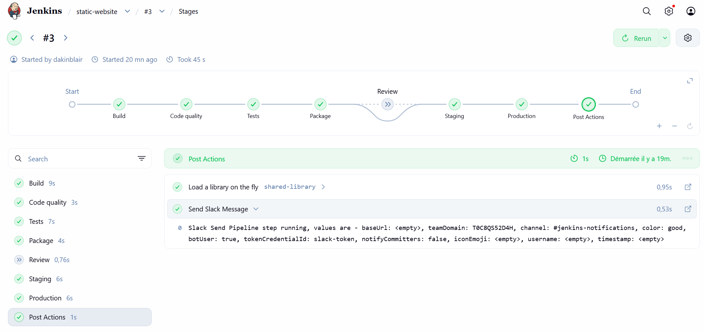
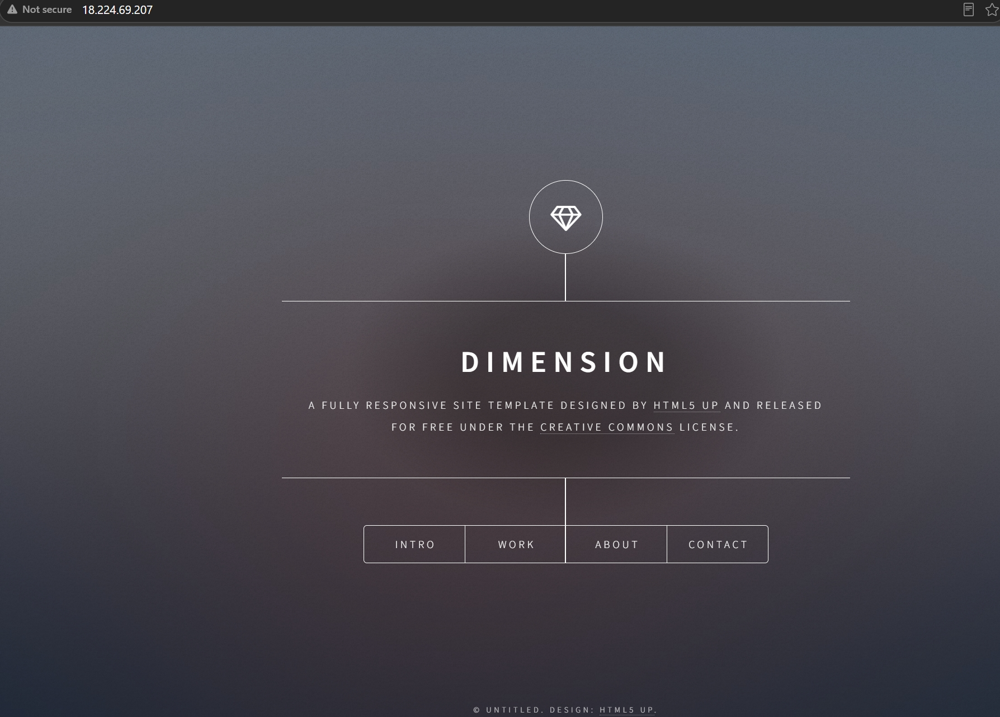
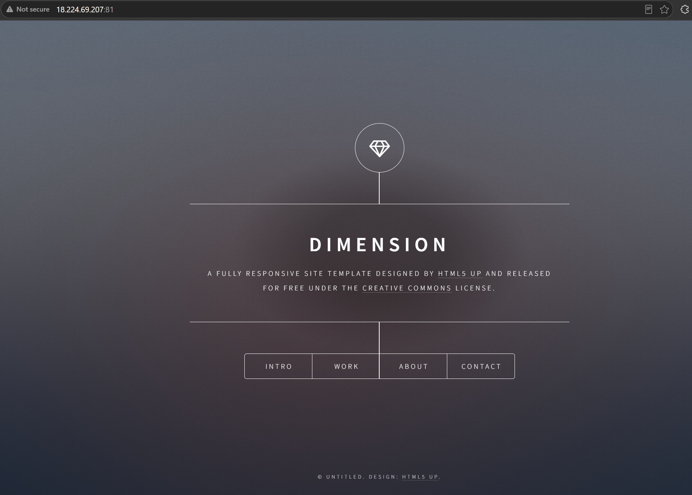
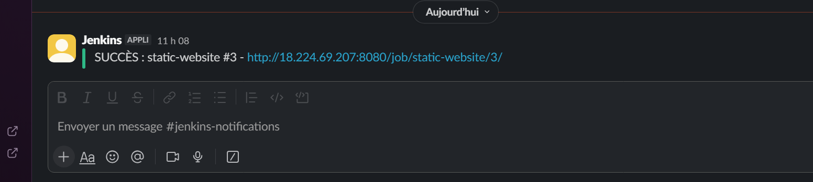
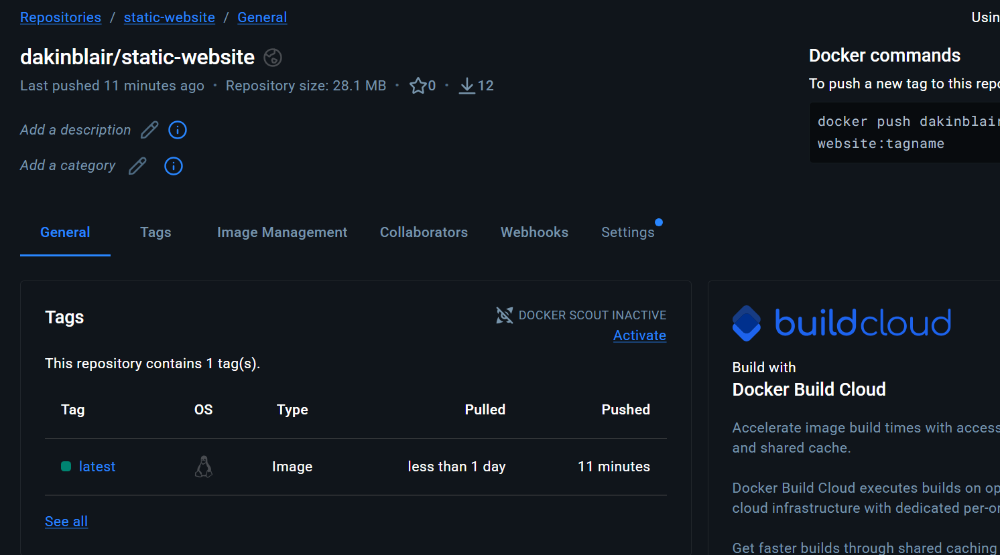
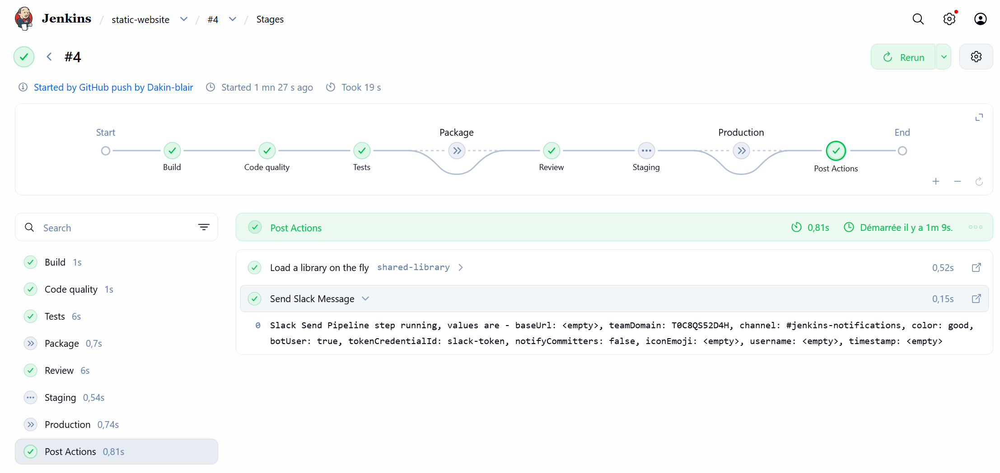
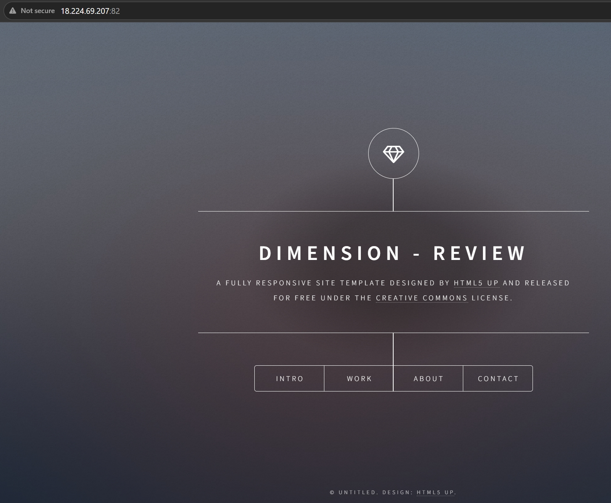
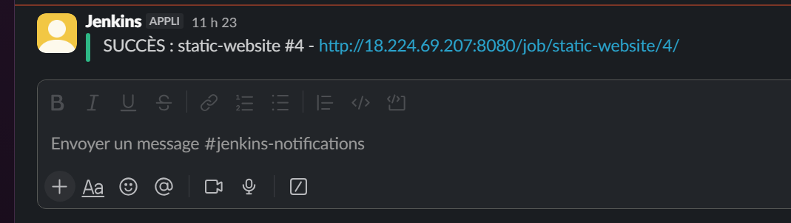

# Mini-projet Jenkins : Static Website

Pipeline **CI/CD Jenkins** qui construit, teste, publie et déploie le site statique **Dimension** sur une VM **AWS EC2**.

## Architecture

```
GitHub (push) -> webhook -> Jenkins (VM EC2, Docker)
  CI : Build -> Code quality -> Tests -> Package (Docker Hub)
  CD : Review (autres branches) | Staging -> Production (master)
  -> Notification Slack (shared library)
```

| Élément | Choix |
|---|---|
| **Serveur** | AWS EC2 **t3.small**, Ubuntu 24.04, 2 Go de swap |
| **Jenkins** | Conteneur jenkins/jenkins:lts, avec accès au Docker de la VM |
| **Image du site** | nginx:alpine + fichiers du site |
| **Registre** | Docker Hub : **dakinblair/static-website** |
| **Notifications** | Slack, via une **shared library** Jenkins |

## Étapes du pipeline

| Étape | Rôle | Branche |
|---|---|---|
| **Build** | Construit l'image Docker du site | Toutes |
| **Code quality** | Analyse le Dockerfile avec **hadolint** | Toutes |
| **Tests** | Lance un conteneur temporaire et vérifie la page avec curl | Toutes |
| **Package** | Pousse l'image sur **Docker Hub** | master |
| **Review** | Déploie et teste sur le port **82** | Autres branches |
| **Staging** | Déploie et teste sur le port **81** | master |
| **Production** | Déploie et teste sur le port **80** | master |
| **Post Actions** | Notification Slack (succès ou échec) | Toutes |

## Environnements

| Environnement | Port | Conteneur |
|---|---|---|
| **Review** | 82 | review-static-website |
| **Staging** | 81 | staging-static-website |
| **Production** | 80 | production-static-website |

## Fichiers du dépôt

| Fichier | Rôle |
|---|---|
| **Dockerfile** | Image nginx qui sert le site |
| **.dockerignore** | Exclut les fichiers qui ne font pas partie du site |
| **Jenkinsfile** | Définition du pipeline |
| **screenshots/** | Captures des résultats |

## Reproduire le projet

### 1. Prérequis

- Une machine avec **Docker** et **Jenkins**. Jenkins doit pouvoir lancer des commandes docker.
- Plugins Jenkins : **Git**, **Pipeline**, **GitHub**, **Credentials Binding**.
- Facultatif : **Slack Notification**, si les notifications sont activées.

### 2. Credentials Jenkins

Administrer Jenkins -> Credentials -> Global :

| ID | Type | Contenu |
|---|---|---|
| **dockerhub** | Username with password | Utilisateur Docker Hub + jeton d'accès |
| **slack-token** | Secret text | Token du bot Slack (facultatif) |

### 3. Variables à adapter

Dans le bloc **environment** du **Jenkinsfile** :

| Variable | Valeur actuelle | À changer |
|---|---|---|
| **ID_DOCKER** | dakinblair | Votre utilisateur Docker Hub |
| **HOST_IP** | 172.17.0.1 | IP de l'hôte Docker vue depuis Jenkins |
| **SLACK_ENABLED** | true | false sans Slack ni shared library |

### 4. Job Jenkins

Nouveau Item -> **Pipeline** :

| Champ | Valeur |
|---|---|
| Triggers | **GitHub hook trigger for GITScm polling** |
| Definition | **Pipeline script from SCM** |
| Repository URL | URL du dépôt |
| Branch Specifier | \*\* (toutes les branches) |
| Script Path | Jenkinsfile |
| Lightweight checkout | **Décoché** (obligatoire avec toutes les branches) |

### 5. Webhook GitHub

Settings -> Webhooks -> Add webhook :

- Payload URL : http://IP_JENKINS:8080/github-webhook/
- Content type : application/json
- Événement : **Just the push event**

### 6. Ports à ouvrir (groupe de sécurité AWS)

| Port | Source | Rôle |
|---|---|---|
| 80 | Tout le monde | Production |
| 81 | IP de l'administrateur | Staging |
| 82 | IP de l'administrateur | Review |
| 8080 | IP de l'administrateur + plages webhook GitHub | Jenkins |
| 22 | IP de l'administrateur + EC2 Instance Connect | SSH |

## Tester sans Jenkins

L'image est publique sur Docker Hub :

```
docker run -d --name static-website -p 8090:80 dakinblair/static-website:latest
curl http://localhost:8090
```

Puis ouvrir **http://localhost:8090** dans un navigateur.

## Résultats

### Pipeline sur master (build #3)

Review sautée ; Staging et Production déployés.



### Production (port 80)



### Staging (port 81)



### Notification Slack (master)



### Image sur Docker Hub



### Pipeline sur la branche review-test (build #4)

Déclenché par le **webhook**. Seule l'étape Review déploie ; Package, Staging et Production sont sautés.



### Review (port 82)

Le titre modifié sur la branche apparaît uniquement en Review. La production reste inchangée.



### Notification Slack (review)



## Remarques

- L'**IP publique** de la VM change à chaque redémarrage : mettre à jour le webhook et l'URL de Jenkins.
- Aucun secret n'est stocké dans le dépôt : les identifiants passent par les **credentials Jenkins**.
- Le design du site est le modèle **Dimension** de **HTML5 UP** (https://html5up.net), sous licence **Creative Commons Attribution 3.0** (https://html5up.net/license).
